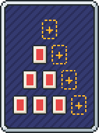

# Expanding Deck

A Balatro deck where your **Joker slots equal the current Ante**.

## How it works

- Start with **1** Joker slot at Ante 1, then gain a slot every Ante: 8 at Ante 8, 39 at Ante 39.
- If the Ante goes down (Hieroglyph, Petroglyph, etc.) you lose slots, but never drop below 1. Jokers over the limit are kept; you just can't add more until slots catch up.
- Other slot bonuses (Antimatter, Negative jokers, Cryptid effects) stack on top.

## Install

Requires [Steamodded](https://github.com/Steamodded/smods) (1.0.0 beta or later).

Copy the `ExpandingDeck` folder into `%AppData%\Balatro\Mods` and restart the game. The deck appears at the end of the deck list.